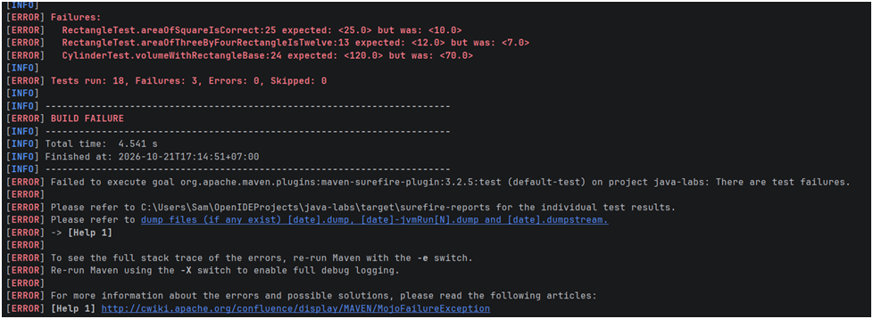
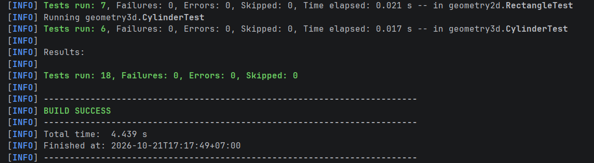

# Лабораторная работа № 4. Сборка проекта с Maven и модульное тестирование с JUnit

**ФИО автора:** Гуляева Арина Евгеньевна \
**Группа:** ФИТ-251

## Описание работы
Проект переведен на систему сборки Maven. Настроена компиляция под Java 25 и кодировку UTF-8. Подключена библиотека JUnit Jupiter (версия 6.1.3) для написания модульных тестов. Настроена сборка исполняемого JAR-файла с указанием главного класса.

## Команды для сборки, тестирования и запуска
*(Для Windows используйте `mvnw.cmd` вместо `./mvnw`)*

1. **Запуск тестов:**
   `./mvnw test`
2. **Сборка исполняемого JAR (с тестами):**
   `./mvnw clean package`
3. **Запуск приложения:**
   `java -jar target/java-labs-1.0-SNAPSHOT.jar`

## Проверка обнаружения ошибки (Задание № 5)

В рамках выполнения задания была проведена проверка того, что написанные тесты действительно отслеживают ошибки в логике работы классов.

**Шаг 1: Внесение ошибки**
В классе `Rectangle` метод `area()` был временно изменен с `width * height` на `width + height`.
При запуске команды `./mvnw test` сборка завершилась с ошибкой (`BUILD FAILURE`). Упали 3 теста, в том числе `RectangleTest.areaOfThreeByFourRectangleIsTwelve` с сообщением: `expected: <12.0> but was: <7.0>`. Также упал тест цилиндра, так как он использует площадь прямоугольника.

**Скриншот упавших тестов:**

**Шаг 2: Исправление**
Формула была возвращена в исходное состояние (`width * height`).
При повторном запуске `./mvnw test` все 18 тестов прошли успешно, сборка завершилась сообщением `BUILD SUCCESS`.

**Скриншот успешной сборки:**
